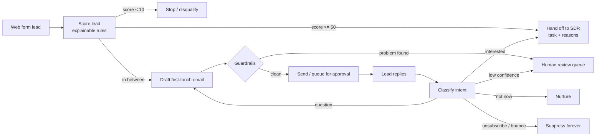

# AI First-Touch SDR Agent

An AI agent that takes the first touch on every inbound lead. It scores the lead, writes a short personal email, reads the reply, and hands qualified buyers to a human SDR. Sales reps only work leads that are ready to talk.

> **About this repo.** I built and run the production version of this agent at a medical aesthetics device company (Claude API + HubSpot). This is a clean-room rebuild of the same design with synthetic data, so the code is public and runs with no keys. No company data, prompts or customer records are included.

## The business problem

- Inbound web-form leads sat in a queue until an SDR had time to email them.
- SDRs spent hours each week on first emails that went nowhere: students, job seekers, "just curious" fills.
- Speed-to-lead was slow, and good leads cooled off.

## What it does



## Results in production

| Metric | Result |
|---|---|
| Manual SDR effort removed | **~12 hours / week** |
| Drafts and reply labels reviewed by hand before going autonomous | **50+** |
| Leads reaching SDRs | Only qualified ones, each with the reasons it qualified |

## Design decisions (and why)

1. **Email first, not voice.** I tested voice as the first channel and dropped it. Email is cheaper, easier to audit, and buyers in this market reply to email.
2. **Built custom on the Claude API + HubSpot,** not an off-the-shelf AI SDR tool. We needed our own scoring rules, our CRM fields, and full control of what gets sent.
3. **Draft-for-approval rollout.** The agent started in `draft` mode. Every email waited for a human. Only after 50+ clean drafts did I switch to `autonomous`, and guardrail failures still go to a human.
4. **Explainable scoring.** Every point has a written reason. SDRs see *why* a lead was routed, so they trust it.
5. **Opt-outs win, always.** An unsubscribe is honored even when the classifier is unsure. Bounces are suppressed.
6. **Clear pause signal.** A wrong recipient or a wrong draft stops the rollout. The guardrails check for both before anything sends.

## Run it

```bash
pip install pytest
python run_demo.py        # full flow on 5 synthetic leads
python -m pytest -q       # 10 tests
```

Live mode (optional): set `ANTHROPIC_API_KEY` and the agent uses Claude for reply classification and email writing. `HubSpotCRM` in `sdr_agent/crm.py` shows the CRM calls.

## Code map

| File | What it does |
|---|---|
| `sdr_agent/qualify.py` | Lead scoring with a reason for every point |
| `sdr_agent/drafter.py` | Email templates the LLM personalizes |
| `sdr_agent/llm.py` | `ClaudeClient` (live) and `RuleBasedClient` (offline) behind one interface |
| `sdr_agent/guardrails.py` | Wrong-recipient, suppression, banned-claim and length checks |
| `sdr_agent/pipeline.py` | The agent loop and the rollout modes |
| `sdr_agent/crm.py` | CRM adapter (in-memory + HubSpot) |

## What I would add next

- A labeled test set of real replies to track classifier accuracy over time (today the check is human review).
- Alerts on bounce rate and misclassification rate.
- A/B tests on subject lines and first-touch copy.

---
Built by [Vrutik Adani](https://www.linkedin.com/in/vrutikadani) · GTM Systems & AI Engineering
