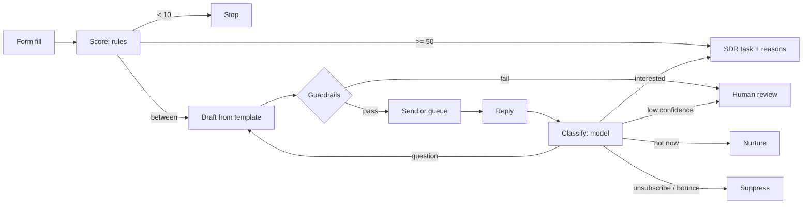

# ai-sdr-agent

[](https://github.com/vrutikadani/ai-sdr-agent/actions/workflows/ci.yml)

First touch on inbound leads: score the lead, send one short email, read the reply, and hand real buyers to an SDR with the reasons attached.

This is a reference implementation of an agent I designed and operate on the Claude API and HubSpot. It is rebuilt from scratch with synthetic leads. No production prompts, data or source code are included.

## Why it exists

Inbound form fills waited in a queue until an SDR had time. Most of them were students, job seekers or "just curious," so SDR hours went into first emails that went nowhere while real buyers cooled off. The production version removed roughly 12 hours a week of that work.

## Who decides what

The design question was not "what can the model do" but "what should it never be allowed to decide."

| Decision | Made by | Why |
|---|---|---|
| Is this lead worth an email? | Rules (`qualify.py`) | SDRs have to trust the routing, so every point has a written reason |
| Is this address suppressed? | Rules (`crm.py`) | An opt-out is a legal fact, not a judgment call |
| Is this draft safe to send? | Rules (`guardrails.py`) | Wrong recipient, unfilled template, banned claims and length are checkable |
| What did the reply mean? | Model (`llm.py`) | The only genuinely ambiguous step |
| What happens next? | Rules (`pipeline.py`) | The model's label picks a branch; it never writes to the CRM directly |
| Anything uncertain | A person | Confidence below 0.6, an unclear label, or any guardrail failure goes to review |

Two rules override everything else: an unsubscribe is honored even when the classifier is unsure, and a hard bounce suppresses the address permanently.



## Rollout

The agent has two modes. In `draft`, every email waits for a person. It stayed there until I had reviewed 50+ drafts and reply labels without a wrong one, and only then moved to `autonomous`. Even in `autonomous`, a guardrail failure still queues for review. The stop condition was agreed in advance: one email to the wrong person, or one wrong draft, pauses sending.

## Failure modes

| What goes wrong | What the system does |
|---|---|
| Model returns malformed or unexpected output | Parsed as `unclear` with confidence 0, goes to review |
| Model is confident but wrong on an opt-out | Opt-out patterns are checked first; unsubscribe wins regardless of confidence |
| Draft greets the wrong person or leaks a `{{variable}}` | Blocked before send, lead marked `needs_review` |
| Same address submits the form again after opting out | Stopped at intake by the suppression list |
| Bounce | Address suppressed; lead disqualified |
| Out-of-office reply | Ignored; the agent waits for a real reply |

## Evaluation

`evals/replies.jsonl` holds 40 labeled replies, including the awkward ones: a request for pricing followed by "never mind, take me off your list," a bare "STOP," a confused "who is this?" `evals/run_eval.py` runs each one through the full loop and grades two things separately:

- **Label accuracy:** did the classifier pick the right intent?
- **Workflow outcome:** did the agent take the right action?

The second is what matters. Outcomes are graded by cost: a wrong label that lands in human review is a *safe miss*; an SDR task for a non-buyer, or a buyer who gets a question instead of a call, is *costly*; any opt-out that isn't honored is *critical*, and CI fails on it.

The first run caught three critical misses in the opt-out rule ("take me off your mailing list," "Don't email me," "STOP"). The rule was widened in the next commit. Current offline result:

```
label accuracy:     88%
correct action:     88%
outcomes:           costly 3, ok 35, safe-miss 2
```

The three costly cases are buyers the offline rule-based client reads as questions ("Who do I talk to about financing?"). That is a limit of the regex stand-in. The same set runs against Claude when `ANTHROPIC_API_KEY` is set, which is the comparison that matters before changing a prompt or a model.

The opt-out rule is deliberately over-inclusive: "don't email me, call instead" is treated as an opt-out. A lost lead costs less than an ignored opt-out.

## What I watch

Reply-label mix week over week, review-queue volume, bounce and opt-out rates, and how many handoffs SDRs reject. A jump in any of them means the inputs changed (new form, new campaign, new market) before it means the model got worse.

## Tradeoffs

- **Email, not voice.** I tested voice as the first channel and dropped it. Email is cheaper, auditable, and this buyer replies to email.
- **Built, not bought.** Off-the-shelf AI SDR tools couldn't use our scoring rules or CRM fields, or give us control of what gets sent.
- **Templates the model fills, not free-form writing.** Less "personal," much easier to review and much harder to get wrong.

## Limitations

- Replies are matched to leads by ID. There is no email-thread reconciliation, which production needs.
- Reply handling is not idempotent; the same reply processed twice would create a second SDR task.
- The evaluation set is synthetic and small. In production the check is still human review of live replies; real labeled replies should replace these over time.
- `HubSpotCRM` shows the shape of the CRM calls but only writes status and score.

## Run

```bash
pip install pytest
python run_demo.py      # 5 synthetic leads through the full loop
python -m pytest -q     # scoring, suppression, guardrails, handoff, bounce, low-confidence routing
python evals/run_eval.py   # label accuracy vs workflow outcome on 40 labeled replies
```

Set `ANTHROPIC_API_KEY` to classify replies with Claude instead of the offline rule-based client. Both sit behind the same interface in `sdr_agent/llm.py`.
