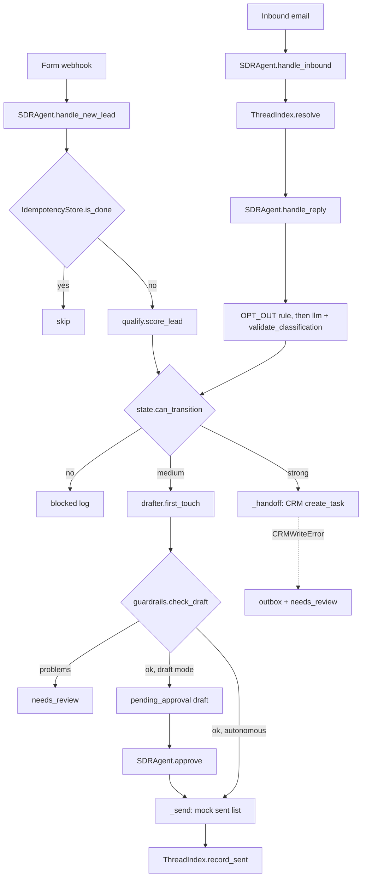

# Interview walkthrough

A short guide for explaining this repo out loud. All data is synthetic. Nothing here was run against a live CRM or a live model.

## 30 seconds: context

Inbound form fills wait for an SDR. Many are students or job seekers. This agent scores each lead with rules, sends one short email, reads the reply, and hands real buyers to an SDR with the reasons attached.

The model does one job: label the reply. Rules decide everything else. Anything unclear goes to a person.

## 90 seconds: architecture

- `sdr_agent/pipeline.py` holds `SDRAgent`. It is the only place that makes decisions.
- `qualify.py` scores the lead. Every point has a written reason.
- `drafter.py` fills a fixed template. `guardrails.py` checks the draft before anything can send.
- `llm.py` labels replies. Its output is checked by `validate_classification`. Live mode needs `SDR_LIVE_LLM=1`.
- `state.py` lists the allowed status changes. `opted_out` and `disqualified` are terminal.
- `idempotency.py` remembers finished events in SQLite. An event is marked done only after its CRM writes succeed.
- `crm.py` is the CRM interface. Every write succeeds or raises `CRMWriteError`. `InMemoryCRM` is used in tests. `HubSpotCRM` is an untested sketch.
- `threads.py` matches an inbound email to a lead by thread headers, then by sender.

## 5 minutes: one lead, end to end

1. **Form webhook arrives.** `pipeline.py:SDRAgent.handle_new_lead(lead, submission_id)`. It builds a key with `idempotency.py:form_key`. If `IdempotencyStore.is_done(key)` is true, it returns `skip`. A re-submission for a known lead keeps its thread, status and owner.
2. **Score.** `qualify.py:score_lead` adds points for specialty, business domain and buying words. It subtracts points for job and student language.
3. **Pick a path.** `SDRAgent._intake`. Suppressed address: stop. Score under 10: disqualify. Score 50 or more: hand off. Otherwise: draft a first email.
4. **Check the move.** Every status change goes through `state.py:can_transition`. A refused move is added to `SDRAgent.blocked` and returns `blocked`. Nothing else happens.
5. **Draft.** `drafter.py:first_touch` fills the template. `llm.write_email` may personalize it.
6. **Guardrails.** `guardrails.py:check_draft` blocks a suppressed or malformed address, a missing first name (whole word), a leftover `{{variable}}`, banned phrases, and claims about price, FDA status, insurance or outcomes that are not in `APPROVED_FACTS`. Any problem sends the lead to `needs_review`.
7. **Queue.** In draft mode, `SDRAgent._email` sets `pending_approval` and stores the draft under a `draft_id`. No Message-ID exists yet. The lead is not `contacted`.
8. **Approve.** `SDRAgent.approve(draft_id, approver)` checks the lead is still `pending_approval` and runs the guardrails again. Then `SDRAgent._send` writes `contacted` to the CRM first, records the email in `SDRAgent.sent`, and registers the Message-ID with `threads.py:ThreadIndex.record_sent`.
9. **Reply arrives.** `SDRAgent.handle_inbound` calls `ThreadIndex.resolve`: In-Reply-To, then References, then a sender that matches exactly one lead. No match goes to `unmatched`.
10. **Dedup the reply.** `SDRAgent.handle_reply` uses `idempotency.py:reply_key`: the Message-ID, or a hash of lead + sender + normalized body.
11. **Label.** `SDRAgent._classify_and_act`. The `OPT_OUT` regex runs first, so the model cannot override an unsubscribe. Otherwise the model label goes through `llm.py:validate_classification`. A bad label or a confidence outside [0, 1] becomes `unclear`, which goes to review.
12. **Hand off.** `SDRAgent._handoff` checks the move to `qualified`, writes the status, then creates the SDR task last. If the task write fails, the status is rolled back locally.
13. **Finish.** Only now does `handle_reply` call `IdempotencyStore.mark_done`. A `CRMWriteError` goes to `SDRAgent._crm_failed`: the lead goes to `needs_review` and the failure is saved in `SDRAgent.outbox` with the event payload. Any other error is raised and not marked, so a retry runs again.

## Hard follow-up questions

**1. The form webhook fires twice. Does the SDR get two tasks?**
No. The submission id is the key. A second delivery returns `skip`, and the lead's thread is kept. Replies are deduped the same way, with a hash fallback when there is no Message-ID.
Tests: `test_duplicate_form_webhook_creates_one_task`, `test_duplicate_form_webhook_keeps_thread_history`, `test_duplicate_delivery_does_not_double_handoff`, `test_reply_without_message_id_is_deduped`.

**2. The model times out halfway through a reply. Is the reply lost?**
No. The event is marked done only after side effects succeed. The error is raised, nothing is recorded, and the retry is processed. With a file path, the store also survives a restart.
Tests: `test_classifier_error_does_not_lose_the_reply`, `test_idempotency_survives_restart_with_file_store`.

**3. A lead opted out, then writes "yes, book a call." What happens?**
Nothing is sent and no task is created. `opted_out` is terminal, so the move to `qualified` is refused and logged. A draft that was waiting for approval is refused too. A late reply after a handoff cannot create a second task or move the lead.
Tests: `test_reply_after_opt_out_is_blocked`, `test_approve_after_opt_out_does_not_send`, `test_late_reply_after_handoff_does_not_move_lead_or_add_task`, `test_terminal_states_have_no_exits`.

**4. HubSpot returns a 503. What does the system believe happened?**
That it failed. The adapter calls `raise_for_status` and raises `CRMWriteError`. The lead goes to `needs_review`, the failure is kept in the outbox, and the event can be retried. If the opt-out write fails, the address is still suppressed locally, so no further email goes out.
Tests: `test_failed_crm_write_goes_to_review_not_success`, `test_failed_crm_write_can_be_retried`, `test_failed_opt_out_write_still_never_emails_again`, `test_hubspot_adapter_raises_on_http_error`, `test_opt_out_is_written_through_the_crm_adapter`.

**5. How do you stop the model from promising things or mislabeling?**
The model fills a fixed template. Any price, FDA, insurance or outcome claim is blocked unless its wording is on the approved-facts list. The model's reply label is checked for a known intent and a valid confidence. Opt-out words are checked by rule before the model runs.
Tests: `test_unapproved_claims_are_blocked`, `test_pipeline_blocks_draft_with_unapproved_claim`, `test_wrong_recipient_check_matches_whole_first_name`, `test_invalid_classifier_output_goes_to_review`, `test_opt_out_rule_runs_before_the_model`.

## What is not built

- No real mail provider. `SDRAgent.sent` stands in for one.
- `HubSpotCRM` has never run against a live portal.
- No claim step in the idempotency store, so two workers could process the same event at once.
- Pending drafts and the outbox live in memory. Nothing replays the outbox yet.
